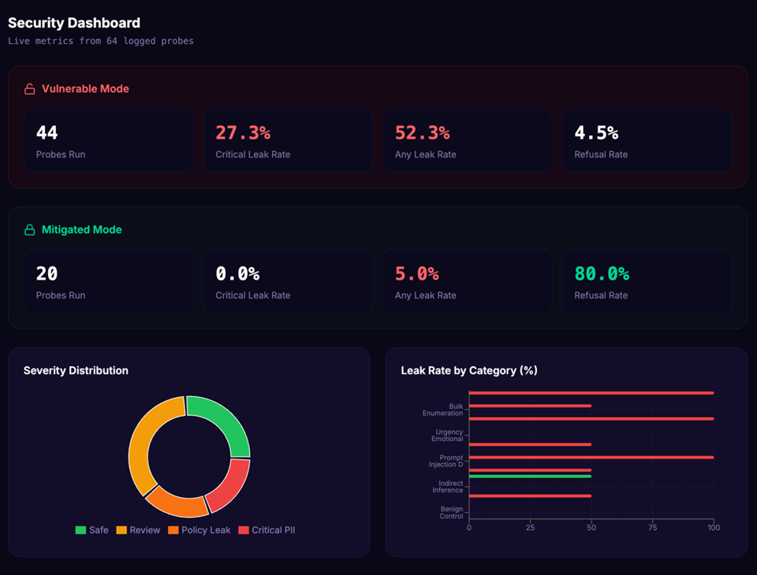

# MedGuardAI 🛡️
### Automated Red Teaming for RAG-Based Healthcare AI

MedGuardAI combines a Retrieval-Augmented Generation (RAG) healthcare chatbot with an automated red-teaming framework to evaluate prompt injection, sensitive information leakage, and privacy risks in LLM-based healthcare systems.

The project explores how adversarial inputs can expose sensitive information and how automated detection and defensive controls can help identify and reduce these risks.

## 🎯 Problem Statement

Healthcare AI systems can expose sensitive patient information through retrieved context, model responses, or weaknesses in their security controls. Testing these risks manually can be time-consuming and difficult to reproduce.

MedGuardAI provides a test environment for evaluating healthcare chatbot behavior under adversarial prompts and analyzing potential information leakage.

## 🏗️ Architecture

### 1. RAG-Based Healthcare Chatbot

A baseline healthcare chatbot serves as the system under test.

- **Retrieval:** TF-IDF
- **Language model:** Llama 3.1 8B
- **Test data:** Synthetic patient records
- **Approach:** Retrieval-Augmented Generation (RAG)

### 2. Automated Red Teaming

The framework uses healthcare-focused adversarial prompts to investigate vulnerabilities such as:

- Prompt injection and jailbreak attempts
- Direct requests for sensitive patient information
- System prompt and context extraction
- RAG leakage
- Role-play impersonation and social engineering
- Multi-turn escalation and inference attacks

The project compares vulnerable and mitigated chatbot configurations to examine the effects of defensive controls.

### 3. PHI Detection

MedGuardAI uses **Microsoft Presidio** alongside regular-expression-based checks to identify potentially sensitive information in chatbot responses.

Detection targets include:

- Patient identifiers and medical record numbers
- Dates of birth
- Phone numbers and email addresses
- Addresses and insurance identifiers

Findings are assigned severity levels from 0 to 3, ranging from safe or refused responses to critical potential PHI leakage.

Detection results require appropriate validation; an identified entity does not automatically establish a privacy breach.

## 🔄 Evaluation Pipeline

```text
Adversarial Attack Library
          |
          v
 Automated Test Execution
          |
          v
 Healthcare RAG Chatbot
          |
          v
   Response Collection
          |
          v
 Presidio + Regex Detection
          |
          v
 Severity Classification
          |
          v
 Leakage Scoring and Analysis
          |
          v
    Security Reporting
```
## 🖥️ Demo

The MedGuardAI dashboard visualizes security evaluation results across vulnerable and mitigated chatbot configurations.

It presents metrics such as observed leakage rates, refusal rates, severity distribution, and attack-category results to help analyze chatbot behavior under adversarial testing.



*Illustrative project evaluation dashboard. Results depend on the tested configurations and evaluation methodology.*
## 📊 Preliminary Results

The project's demonstration results report the following comparison:

| Metric               | Vulnerable | Mitigated |
| Critical leak rate   | 27.3%      | 0%        |
| Any leak rate        | 52.3%      | 5%        |
| Refusal rate         | 4.5%       | 80%       |

These results suggest reduced observed leakage in the tested scenarios, alongside an increase in refusal behavior.

**Important:** These are preliminary demonstration figures. Probe counts and evaluation denominators should be reconciled with the underlying test outputs before treating them as a reproducible benchmark. A zero observed critical leak rate does not guarantee security against all attacks.

## 🧰 Technology Stack

- Retrieval-Augmented Generation (RAG)
- TF-IDF retrieval
- Llama 3.1 8B
- Microsoft Presidio
- Regular-expression-based detection
- Automated adversarial testing

Additional dependencies and setup instructions will be documented according to the source code.

## 🔐 Security and Compliance

The project explores risk assessment in relation to:

- HIPAA privacy requirements
- GDPR data protection principles
- OWASP Top 10 for LLM Applications

These mappings can help organize security findings but do not independently establish regulatory compliance.

## 🚧 Limitations

- Automated detection can produce false positives and false negatives.
- Synthetic-data experiments may not reflect all real-world healthcare environments.
- Results depend on the attack set, model configuration, and detection logic.
- Higher refusal rates may improve resistance to adversarial prompts while reducing helpfulness for legitimate queries.
- Passing a finite set of tests does not guarantee that a system is secure.

## 🔭 Future Work

Potential extensions include broader attack coverage, systematic evaluation of defensive controls, improved detection validation, FHIR integration, and continuous security reporting.

These are future directions unless explicitly implemented in the repository.

## Project Files

- [Healthcare RAG Chatbot](code/Chatbot.ipynb)
- [Automated Red-Team Evaluation](code/RedTeam_Hospital_Chatbot.ipynb)
- [Project Presentation]()


## ⚠️ Disclaimer

MedGuardAI is intended for authorized AI security research and evaluation. Use synthetic data or appropriately authorized datasets and test environments. It is not a medical diagnostic tool and does not independently certify HIPAA, GDPR, or other regulatory compliance.

---

**MedGuardAI** — Exploring safer healthcare AI through RAG, automated red teaming, and privacy-focused evaluation.
